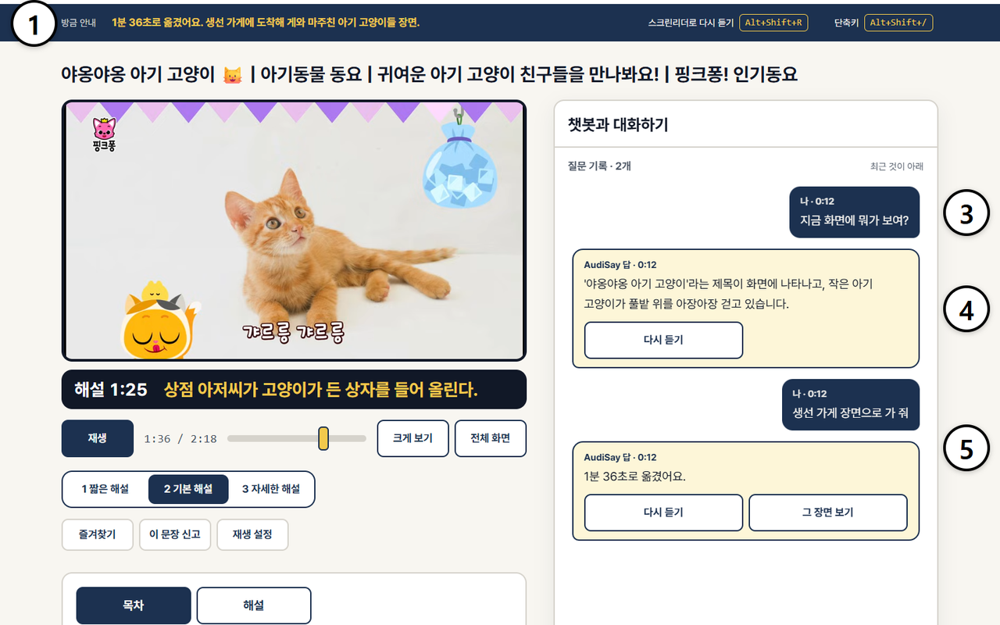
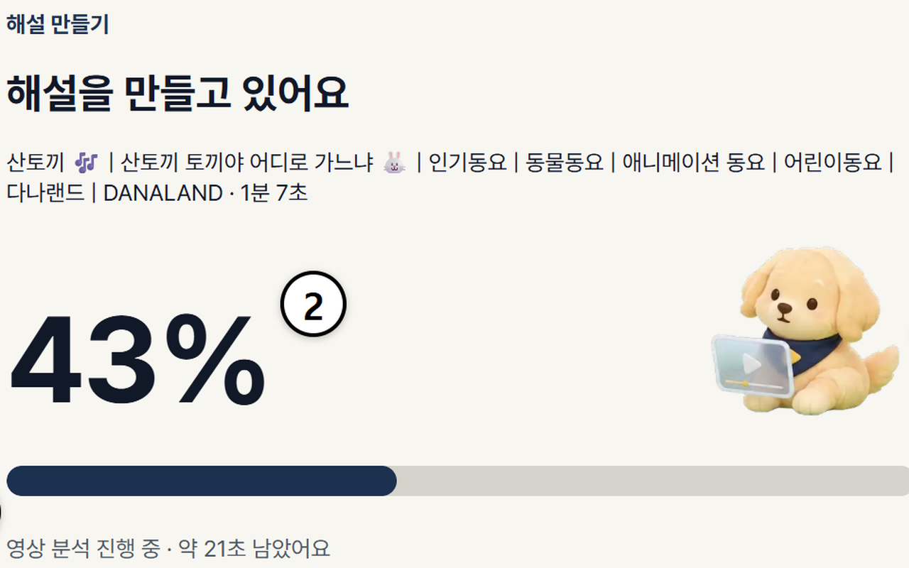
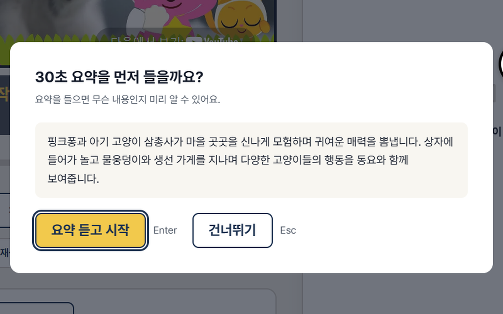
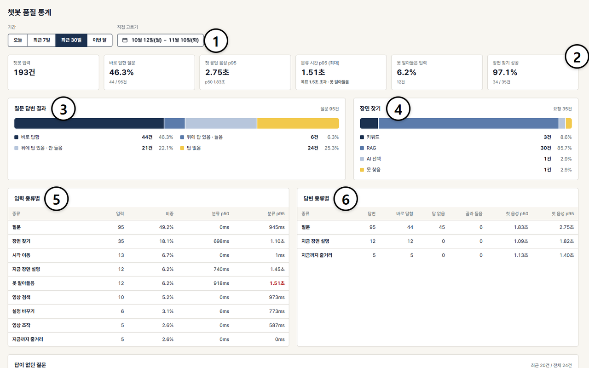
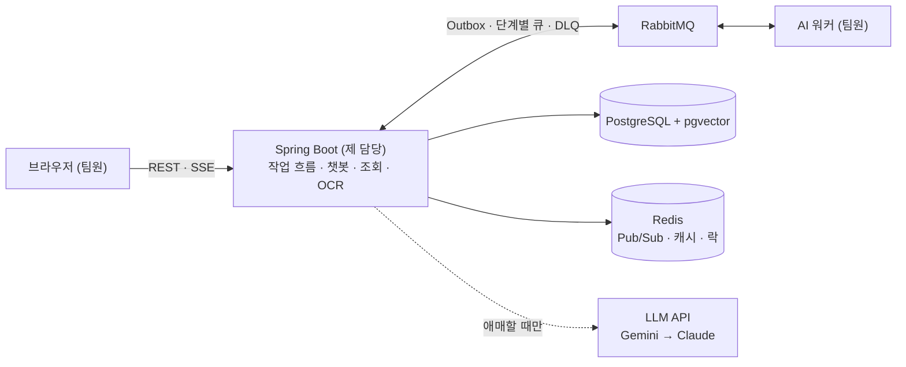

# AudiSay — 제가 맡은 부분 (이윤우)

6명이 만든 AudiSay에서 제가 맡은 부분만 항목별로 정리한 문서입니다. 서비스 전체 소개와 실행 방법은 [README](README.md)에 있습니다.

## 1. Project Overview

- 프로젝트명: AudiSay — 시각장애인을 위한 AI 영상 화면해설 서비스. 해설을 듣기만 하지 않고 "방금 누가 골 넣었어?"처럼 묻고 원하는 장면으로 옮겨 갈 수 있습니다
- 개발 기간: 2026.10.13 ~ 2026.11.18 (기획 포함. 개발 마감 11.06, 최종 발표 11.18) — SSAFY 15기 2학기 자율 프로젝트
- 팀 구성: 6명 (AI·백엔드 1(본인) · 백엔드 1 · AI 1 · 인프라·프론트 1 · 프론트 2)
- 담당 역할: 백엔드·AI 팀원. Spring Boot 백엔드에서 해설 생성 작업 흐름, 해설 조회, 음성 챗봇(LLM·RAG), 인증 서류 OCR, 사용량 통계를 맡았습니다. 팀장은 따로 있습니다
- GitHub: https://github.com/luster-woo/AudiSay
- 기술 스택 (제가 쓴 것): Java 21 · Spring Boot 4 · JPA · Flyway · PostgreSQL 16 + pgvector · Redis(캐시·Pub/Sub·락) · RabbitMQ · Resilience4j · SSE · ONNX Runtime(PaddleOCR) · JUnit · Mockito · WireMock · k6 · Python(평가·측정 스크립트)

## 2. My Contribution

화면

화면은 프론트 팀원들이 만들었고, 저는 이 화면들이 부르는 서버를 맡았습니다. 팀 포팅 매뉴얼의 캡처를 같은 크기로 잘라 썼고, 누르면 원본이 열립니다.

| 재생 화면과 음성 챗봇 | 해설 생성 중 |
| :---: | :---: |
|  |  |
| “생선 가게 장면으로 가 줘”라고 하면 장면을 찾아 1분 36초로 옮깁니다 | 진행률은 서버가 SSE로 보냅니다 |
| **30초 요약** | **관리자 챗봇 품질 통계** |
|  |  |
| 해설 조회 API 네 개 가운데 하나입니다 | AI 호출 기록으로 집계합니다. 11월 10일 기준 최근 30일, 팀원과 테스트 계정이 쓴 값입니다 |

직접 담당한 기능과 개발 범위

- 해설 생성 작업 흐름: RabbitMQ 큐·재시도·DLQ 선언, Outbox와 발행 확인, 이벤트 중복 처리, 작업 상태 조회와 진행률 SSE, 멈춘 작업 정리 스케줄러
- 해설 조회 API 4개: 재생용 전체, 30초 요약, 장면 목차, 지금 장면 설명
- 음성 챗봇 전체: 말의 의도 분류(9종), 장면 찾기(키워드 + 벡터 검색), 질문 답변 SSE, 줄거리, 화면 다시 보기, 평가 문항 192개와 기능 스위치 9개
- 인증 서류 OCR 판정: PaddleOCR 모델(ONNX)을 Spring 안에서 실행
- LLM 호출 공통부: 용도별 서킷 브레이커, 대체 모델, 호출 기록, 관리자용 AI 사용량·챗봇 품질 통계 API
- 측정: 장애 주입 측정 도구, 챗봇·RAG 평가 스크립트, k6 부하 테스트 시나리오 4개
- 그 밖에: 백엔드 초기 세팅, API 명세 문서 관리, 프론트 파일 직접 수정 2건(화면 낭독기와 음성 겹침, 남은 시간 표시)

팀에서 구현한 부분 (제 작업이 아닙니다)

| 영역 | 담당 |
|---|---|
| 해설을 만드는 AI 워커, 해설 프롬프트, GPU 서버, 해설 음성(TTS) 워커, 업로드 영상 분석, 외국어 대사 번역 낭독 | AI 팀원 |
| 회원·인증(JWT), 영상, 업로드(S3), 관리자 API | 백엔드 팀원 |
| EC2·Docker Compose 배포, Jenkins CI/CD, Prometheus·Grafana 모니터링 | 인프라 팀원 |
| 화면 전체, 접근성 화면 | 프론트 팀원 |

`domain/job`과 `domain/description`에는 팀원이 고친 부분도 섞여 있습니다. 남은 시간 예측은 팀원이 만든 기본 로직을 제가 단계별로 고친 것입니다. 코드의 상당 부분은 Claude와 함께 썼고, 구조와 대안 선택, 평가 문항과 채점 기준, 측정과 결과 해석은 직접 했습니다.

## 3. Architecture

전체 시스템 구조

담당 영역의 구조

| 맡은 일 | 코드 위치 |
|---|---|
| 해설 생성 작업 흐름 | [`domain/job`](backend/src/main/java/com/audisay/domain/job), [`global/messaging/outbox`](backend/src/main/java/com/audisay/global/messaging/outbox) |
| 해설 조회 | [`domain/description`](backend/src/main/java/com/audisay/domain/description) |
| 음성 챗봇 | [`domain/chat`](backend/src/main/java/com/audisay/domain/chat) — `intent` · `seek` · `search` · `answer` · `screen` |
| LLM 호출 | [`global/external/llm`](backend/src/main/java/com/audisay/global/external/llm) |
| 인증 서류 OCR | [`global/external/ocr`](backend/src/main/java/com/audisay/global/external/ocr), [`domain/user/verification`](backend/src/main/java/com/audisay/domain/user/verification) |
| 통계 | [`domain/admin/service`](backend/src/main/java/com/audisay/domain/admin/service) |

서버 간 통신 방식

- 브라우저 ↔ Spring: REST. 작업 진행률과 챗봇 답변은 SSE로 보냅니다
- Spring ↔ AI 워커: RabbitMQ 메시지. 단계마다 큐가 따로 있고(`job.prepare` → `job.describe` → `job.merge` → `job.tts`), 실패한 메시지는 10초·30초 뒤 다시 시도하고 세 번째 실패는 DLQ로 보냅니다
- Spring ↔ AI 서버: 음성 인식·합성은 AI 서버의 내부 API를 부릅니다. 실패하면 브라우저 음성으로 넘어갑니다
- Spring ↔ LLM: 규칙으로 처리하지 못한 말만 보냅니다. Gemini가 한도 초과로 거절하면 Claude로 넘어갑니다
- Spring 서버끼리: 진행률 알림은 Redis Pub/Sub로 모든 서버에 전달합니다

데이터 흐름 (해설 하나가 만들어지는 순서)

1. 해설 요청이 오면 작업 행과 보낼 메시지를 같은 트랜잭션에 저장합니다(Outbox)
2. 커밋 뒤 메시지를 발행하고 브로커의 확인을 받습니다. 확인이 없으면 10초 뒤 다시 발행합니다
3. AI 워커가 단계를 끝낼 때마다 이벤트를 보내고, Spring은 작업 행을 잠근 뒤 상태를 바꿉니다
4. 조각 해설이 모두 끝나면 합치기와 음성 단계로 넘어가고, 일부 조각이 실패하면 성공한 구간까지 공개합니다
5. 해설이 공개되면 장면 검색 색인을 만듭니다(이벤트 + 5분 주기 스케줄러)

데이터베이스 구성

- PostgreSQL 16 + pgvector, 스키마 변경은 Flyway로 관리합니다
- 처음 스키마(V1)는 백엔드 팀원이 만들었고, 제가 추가한 것은 Outbox 메시지 표(V4), 챗봇 검색·줄거리·뒤 내용 답변 칸(V5·V6), 장면 검색 색인(V7)입니다
- Redis는 서명 주소 캐시, 진행률 Pub/Sub, 같은 질문 중복 구독 방지에 씁니다

## 4. Key Implementations

### 4-1. 해설 생성 작업 흐름

- 구현 목적: 해설 생성은 AI 워커가 수십 초에서 수 분 걸리는 비동기 작업입니다. 메시지가 사라지거나 이벤트가 겹쳐도 화면은 정상처럼 보여서, 순서·상태·실패를 Spring이 책임지게 했습니다
- 적용 기술: RabbitMQ, Outbox, JPA 행 잠금, Redis Pub/Sub, SSE, 스케줄러
- 구현 과정: 이벤트마다 작업 행을 잠그고, 업무 데이터와 메시지를 한 트랜잭션에 저장한 뒤 커밋 후 발행했습니다. 처리 기록은 커밋 뒤에 남기고, 마지막 활동 시각을 기준으로 멈춘 작업을 정리하는 스케줄러를 뒀습니다
- 기술적 고려사항: 메시지 시스템은 "정확히 한 번"을 주지 않으므로 최소 한 번 전달과 멱등 처리로 만든다는 것을 기준으로 삼았습니다. 장치마다 옛 방식과 지금 방식을 스위치로 바꿀 수 있게 해, 같은 장애를 만들어 비교했습니다(6번 표)

### 4-2. 음성 챗봇 — 규칙 먼저, LLM은 나머지만

- 구현 목적: 말 한 번이 곧 LLM 호출이라 비용과 1~3초 지연이 사용자 경로에 붙습니다
- 적용 기술: 규칙 기반 분류, LLM(SSAFY GMS의 Gemini·Claude), pgvector, RRF, SSE, Resilience4j
- 구현 과정: 평가 문항 192개(의도 112 · 장면 찾기 45 · 답변 35)를 먼저 쓰고, 기능 스위치 9개를 하나씩 켜고 끄며 쟀습니다. 의도 분류는 규칙이 먼저 처리하고 애매한 말만 LLM에 보냅니다. 장면 찾기는 대사·해설 한 줄 단위로 키워드와 벡터 검색을 합치고, 키워드가 확실하면 LLM을 건너뜁니다
- 기술적 고려사항: 답변은 질문한 시각까지의 해설만 자료로 써서 뒤 내용이 새지 않게 했습니다. 답이 뒤에 있으면 "지금 시점 이후에 나와요. 들으시겠어요?"라고 먼저 묻습니다. LLM 장애에 대비해 용도별 서킷 브레이커, 대체 모델, 타임아웃을 두고, 연결이 끊기면 LLM 스트림과 남은 음성을 취소합니다

### 4-3. 해설 조회 성능

- 구현 목적: 재생 화면이 부르는 해설 조회가 동시 요청에서 느렸습니다
- 적용 기술: Redis 캐시, gzip
- 구현 과정: N+1 쿼리와 DB 연결 부족을 의심했지만, 음성 주소 서명을 끈 채 다시 재 보니 바로 빨라졌습니다. 원인은 문장마다 하는 음성 주소 서명(CPU)이었습니다
- 기술적 고려사항: 응답 전체를 캐시하면 관리자가 해설을 고쳤을 때 캐시를 비워야 하고, 수정이 늦게 보이는 문제가 남습니다. 그래서 음성 파일별 서명 주소만 캐시했습니다

### 4-4. 인증 서류 OCR

- 구현 목적: 시각장애인 인증 서류에는 주민번호가 있어서 외부 AI로 보내지 않기로 했습니다
- 적용 기술: PaddleOCR(PP-OCRv5) ONNX, ONNX Runtime, PDFBox
- 구현 과정: 모델을 Spring 안에서 돌리고 앞뒤 처리를 Java로 짰습니다. OCR은 트랜잭션 밖에서 실행하고 동시 1건, 하루 5회로 제한했습니다
- 기술적 고려사항: 제 코드를 다시 점검하다 작은 PNG 한 장으로 서버 메모리가 바닥나는 구멍과, OCR이 오래 걸리면 서류 확인 없이 승인되던 구멍을 찾아 막았습니다

### 4-5. 화면 다시 보기

- 구현 목적: 챗봇은 저장된 해설·대사·화면 글자만으로 답해서, 유니폼 색이나 화면 속 점수처럼 해설에 없는 내용은 "자료에 없어요"로 끝났습니다
- 적용 기술: Gemini 영상 이해(유튜브 구간)
- 구현 과정: 유튜브 주소와 구간(질문한 시각 앞 15초)만 보내 그 구간을 다시 보게 했습니다. 일반 질문은 모델 하나, 숫자 질문은 두 모델을 대조하고, 개수 질문은 세 모델의 답을 범위로 말합니다
- 기술적 고려사항: 실패하면 원래 답으로 돌아갑니다. 뒤에 답이 있는 사건 질문은 프롬프트로는 막히지 않아 코드 규칙으로 갈랐습니다. 직접 올린 영상은 아직 지원하지 않습니다

## 5. Technical Challenges

### 문제 1. 잠금이 없으면 합치기가 두 번이 아니라 한 번도 안 됐습니다

- Situation: 마지막 조각 이벤트 여러 개가 동시에 도착하면 합치기 단계로 넘어가지 못하고 작업이 멈췄습니다
- Cause: 중복 실행을 예상했는데 실제로는 누락이었습니다. 두 트랜잭션이 서로 커밋 전 상태를 읽고 둘 다 "아직 남은 조각이 있다"고 판단했습니다
- Solution: 이벤트를 처리할 때마다 작업 행을 잠갔습니다
- Result: 로컬에서 리스너 10개로 이벤트 1,000개를 한꺼번에 보낸 테스트에서 합치기 누락이 30/100에서 0이 됐습니다. 처리량은 초당 396개와 383개로 거의 같았습니다

### 문제 2. 브로커가 꺼져도 API는 성공을 돌려줬습니다

- Situation: RabbitMQ가 멈춘 동안 해설 요청은 202를 받는데 메시지는 사라졌습니다
- Cause: 커밋한 뒤 바로 발행하는 방식이라, 발행이 실패하면 작업 행만 남았습니다
- Solution: 메시지를 업무 데이터와 같은 트랜잭션에 저장하고, 커밋 뒤 발행해 브로커 확인을 받고, 확인이 없으면 다시 발행하게 했습니다
- Result: 로컬에서 RabbitMQ를 40초 멈춘 채 작업 50개를 만든 테스트에서 메시지 유실이 50/50에서 0이 됐습니다

### 문제 3. 느린 원인이 예상과 달랐습니다

- Situation: 해설 조회가 동시 30에서 p95 0.5초를 넘었습니다
- Cause: N+1 쿼리가 아니라 문장마다 하는 음성 주소 서명이었습니다. 서명을 끈 대조 측정으로 확인했습니다
- Solution: 음성 파일별 서명 주소를 캐시하고 JSON을 gzip으로 압축했습니다
- Result: 로컬, 같은 요청 100회, 동시 30에서 p95 562ms → 61ms, 응답 66.9KB → 10.8KB

### 문제 4. 팀원 기능과 챗봇이 같은 표를 썼습니다

- Situation: 외국어 대사 번역 낭독 기능이 들어오면서 대사 번역 문장이 해설 문장과 같은 표에 저장됐고, 챗봇이 그 문장을 화면 해설로 읽었습니다
- Cause: 두 기능이 같은 표를 쓰는데 읽는 쪽에 문장 종류를 가르는 기준이 없었습니다
- Solution: 표를 나누지 않고, 해설을 읽는 네 곳(질문 답변 자료·지금 장면·줄거리·장면 검색 색인)에 대사 번역 문장을 가려내는 필터를 넣었습니다. 나중에 팀원이 문장 종류 칸을 추가하자 필터가 그 칸을 먼저 보게 맞췄습니다
- Result: 번역 낭독 기능은 그대로 두고 챗봇 답변을 되돌렸습니다. 머지 뒤 전체 흐름 점검 문항 44개를 모두 통과했습니다. 오염 전후를 잰 값은 없습니다

### 문제 5. 부하 테스트의 첫 숫자가 틀렸습니다

- Situation: 계단식으로 부하를 올렸더니 초당 430건에서 꺾이는 것처럼 보였습니다
- Cause: k6가 시험 도중 가상 사용자를 만들면서 같은 PC의 CPU를 먼저 썼습니다. 서버 한계가 아니었습니다
- Solution: 가상 사용자를 처음에 모두 만들고 초당 건수를 고정해 다시 쟀습니다. 병목은 대기 중인 연결 수가 아니라, 커넥션 풀을 바꿨을 때 처리량이 오르는지로 판단했습니다
- Result: 로컬 처리량 천장은 커넥션 풀 10에서 초당 745건, 풀 20에서 895건, 풀 30에서 894건이었습니다. 풀 20부터는 PC의 CPU가 한계였습니다. 운영 풀은 10으로 두었습니다

## 6. Performance & Results

모든 값은 조건과 함께 읽어야 합니다. 로컬 값은 PC 한 대에서 잰 것이고 실사용자 데이터는 없습니다.

장애 주입 (로컬, 옛 방식 → 지금 방식)

| 주입한 상황 | 전 → 후 |
|---|---|
| 리스너 10개, 이벤트 1,000개 동시 | 합치기 누락 30/100 → 0 |
| RabbitMQ 40초 중단, 작업 50개 | 메시지 유실 50/50 → 0 |
| 처리 도중 롤백 뒤 같은 메시지 20개 재전달 | 멈춘 작업 20/20 → 0 |
| 워커 장애 8가지 상태 주입 | 남은 작업 15/24 → 0 (정상 작업 오탐 0/9) |
| 조각 실패율 10%, 작업 100개 | 작업 실패 67% → 13% |

이 장치를 다 넣고 작업 하나에 Spring이 쓰는 시간은 약 162ms, 해설 생성 전체의 0.2~0.6%였습니다.

챗봇 (직접 만든 평가 문항)

| 항목 | 조건 | 전 → 후 |
|---|---|---|
| 의도 분류 | 112문항 | 95.5% → 99.1%, 분류 비용 −77% |
| 장면 찾기 | 98문항 (개발 45 + 확인 53) | 정답 80% → 87%, LLM 비용 −58% |
| 질문 답변 | 35문항 | 29/35 → 35/35, 첫 음성 p95 2.36초 |
| 화면 다시 보기 | 새 유튜브 영상 4개, 14문항 | 9/14 → 14/14, 첫 음성 p50 약 4.4~4.6초 |

API 응답 시간과 처리량

| 항목 | 조건 | 값 |
|---|---|---|
| 해설 조회 | 로컬, 100회, 동시 30 | p95 562ms → 61ms, 응답 크기 −84% |
| 해설 조회 처리량 천장 | 로컬, k6, 초당 건수 고정 | 풀 10에서 초당 745건, 풀 20에서 895건 (실험값) |
| 배포 서버 해설 조회 | EC2 4코어, 읽기 API만, 단계당 1분·1회 | 초당 250건까지 여유(p95 74.6ms), 300건이 한계(p95 131ms) |
| 챗봇 답변 동시 처리 제한 | 로컬, LLM을 800ms 고정 응답으로 대체 | 동시 32건을 넘은 요청만 즉시 거절, 받은 답변 p95 893ms 유지 |
| 30명 33분 연속 사용 | 로컬 | 실패 0, 힙·스레드·DB 연결 늘어남 없음 |
| 인증 서류 OCR | 견본 24장 | 판정 24/24, 한 장 0.96초 |

테스트 결과

- Spring 테스트 636개 중 635개 통과(로컬). 실패 1개는 로컬 AI 워커가 테스트 메시지를 먼저 가져간 환경 문제였습니다

재지 않은 것

- 화면 다시 보기의 비용 전후
- 배포 서버에서의 급증·장시간 부하와 챗봇 부하(실서비스와 비용 때문에 읽기 API만 쟀습니다)
- 실사용자 지표. 배포 서버 기록은 팀원과 테스트 계정이 쓴 값입니다

## 7. Retrospective

개발하면서 배운 점

- 정상처럼 보이는 실패는 일부러 만들어 봐야 보입니다. 브로커가 꺼져도 API는 202를 돌려줬고, 동시 이벤트는 예상(중복)과 반대로 누락을 냈습니다. 장치를 넣을 때마다 끄고 켠 비교와 조건을 같이 남겨야 설명할 수 있는 설계가 된다는 걸 배웠습니다
- 평가 문항이 없으면 "더 좋아졌다"를 말할 수 없습니다. 챗봇은 문항부터 만들고, 개선마다 비용과 지연이라는 대가를 같이 적었습니다

아쉬웠던 점

- 측정이 로컬 PC와 제가 만든 문항 기준입니다. 문항을 개발용과 확인용으로 나누긴 했지만 실사용자 데이터는 없습니다
- 부하 테스트에서 첫 숫자를 결론으로 말했다가 조건을 바꿔 다시 재서 고친 일이 두 번 있었습니다
- 화면 다시 보기는 첫 음성까지 p50 약 4.4~4.6초로, 기존 답변 목표(3초)보다 느립니다
- 팀원이 만든 남은 시간 예측을 단계별로 고쳐 오차 p90을 249%에서 93%로 낮췄지만, 작업 9개 표본이고 첫 예상은 나아지지 않았습니다

현재 다시 개발한다면 개선할 부분

- 해설 조회는 메서드 전체가 한 트랜잭션이라 요청 하나가 DB 연결을 약 13ms 잡습니다. 처리량이 더 필요해지면 커넥션 풀을 늘리기 전에 공개된 해설 응답을 캐시하고, 그다음 트랜잭션 안의 CPU 작업을 줄이겠습니다
- 화면 다시 보기는 유튜브 영상만 됩니다. 직접 올린 영상은 파일을 보내야 해서 이번에는 하지 못했습니다
