<div align="center">

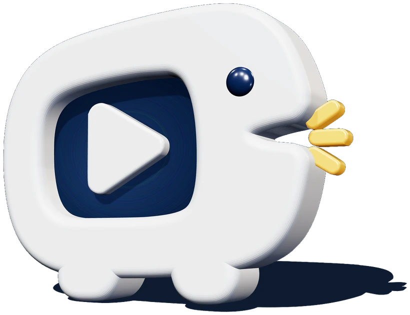

# AudiSay

> 이 저장소에서 이윤우가 맡은 부분은 [PORTFOLIO.md](PORTFOLIO.md)에 따로 정리했습니다.

### 시각장애인을 위한 AI 영상 화면해설 서비스

**보이지 않는 장면까지 목소리로 들려드려요.**

영상을 듣기만 하는 것이 아니라, 직접 묻고 원하는 장면으로 이동할 수 있습니다.

<br />


[서비스 바로가기](https://k15d101.p.ssafy.io) · [시연 시나리오](exec/시연_시나리오.md) · [포팅 매뉴얼](exec/01_포팅매뉴얼.pdf)

</div>

<br />

## 📌 목차

1. [프로젝트 소개](#-프로젝트-소개)
2. [주요 기능](#-주요-기능)
3. [접근성 설계](#-접근성-설계)
4. [기술 스택](#-기술-스택)
5. [시스템 구조](#-시스템-구조)
6. [폴더 구조](#-폴더-구조)
7. [시작하기](#-시작하기)
8. [문서](#-문서)

<br />

## 🐶 프로젝트 소개

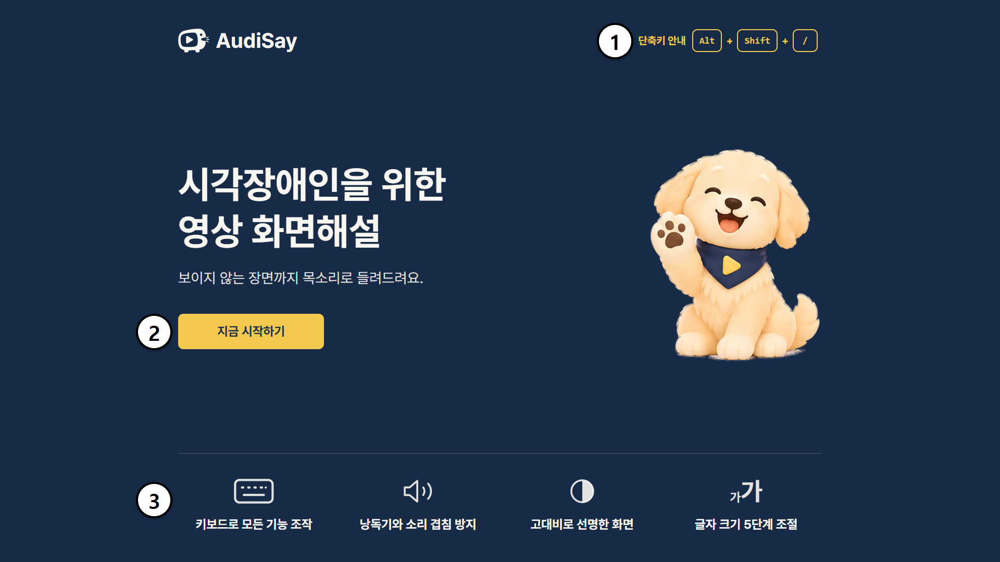

| 항목 | 내용 |
| --- | --- |
| 서비스 | 유튜브 영상과 직접 올린 영상에 AI가 화면해설을 만들어 음성으로 들려주는 웹 서비스 |
| 대상 | 화면낭독기를 쓰는 시각장애인, 저시력 사용자 |
| 기간 | 2026.10 ~ 2026.11 (SSAFY 15기 자율 프로젝트) |
| 주소 | https://k15d101.p.ssafy.io |

**AudiSay가 하는 일**

- 🎬 대사가 없는 사이에 **화면해설 음성**을 넣어, 영상에서 무슨 일이 일어나는지 알려 줍니다.
- 💬 "지금 화면에 뭐가 보여?"처럼 **말이나 글로 질문**하면 그 장면을 바탕으로 답합니다.
- ⏩ "생선 가게 장면으로 가 줘"처럼 말하면 **원하는 장면을 찾아 이동**합니다.
- ⌨️ 모든 기능을 **화면을 보지 않고 키보드와 소리만으로** 쓸 수 있습니다.

<br />

## ✨ 주요 기능

### 1. 영상 찾기와 해설 만들기

<table>
  <tr>
    <th width="50%">홈 · 음성 검색</th>
    <th width="50%">검색 결과</th>
  </tr>
  <tr>
    <td>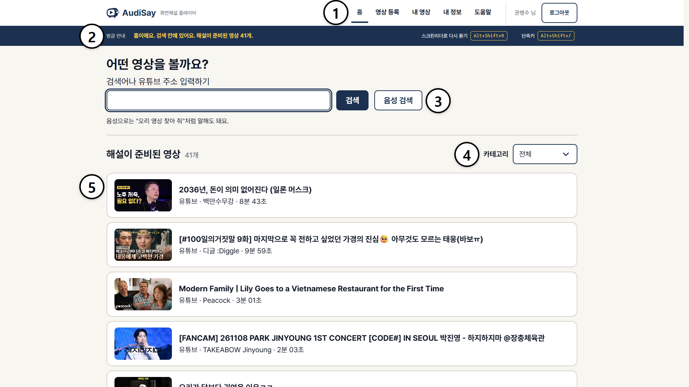</td>
    <td>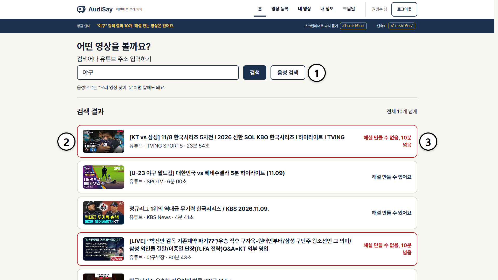</td>
  </tr>
  <tr>
    <td>검색어나 유튜브 주소를 입력하거나, <kbd>Alt</kbd>+<kbd>Shift</kbd>+<kbd>Q</kbd>로 말해서 영상을 찾습니다.</td>
    <td>영상마다 해설을 만들 수 있는지와 그 이유를 바로 알려 줍니다.</td>
  </tr>
  <tr>
    <th>해설 생성 진행</th>
    <th>직접 올린 영상</th>
  </tr>
  <tr>
    <td>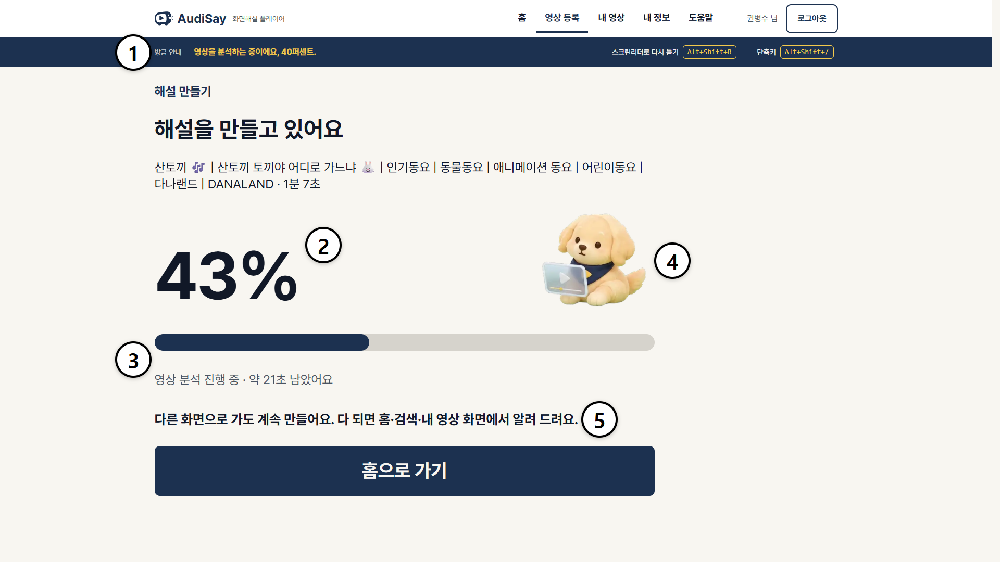</td>
    <td>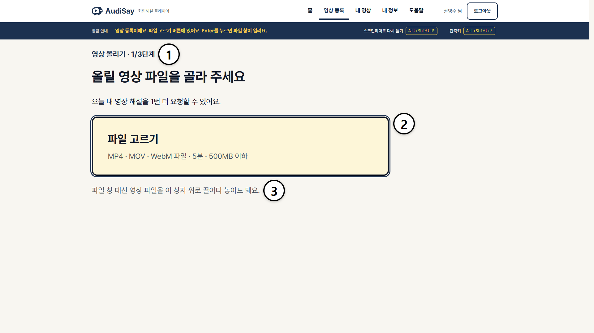</td>
  </tr>
  <tr>
    <td>진행률과 남은 시간을 읽어 줍니다. 다른 화면으로 가도 해설은 계속 만들어집니다.</td>
    <td>MP4·MOV·WebM 파일(5분·500MB 이하)을 올려 내 영상의 해설을 만듭니다.</td>
  </tr>
</table>

### 2. 화면해설과 함께 영상 보기

<table>
  <tr>
    <th width="50%">30초 요약</th>
    <th width="50%">영상 보기</th>
  </tr>
  <tr>
    <td>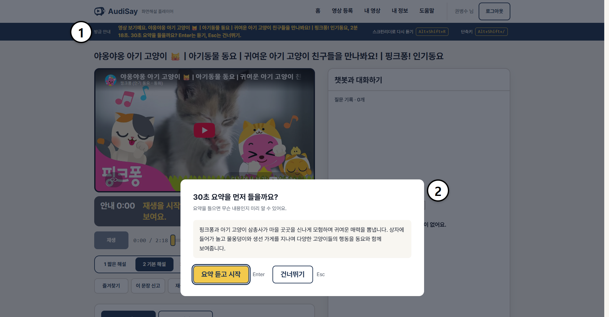</td>
    <td>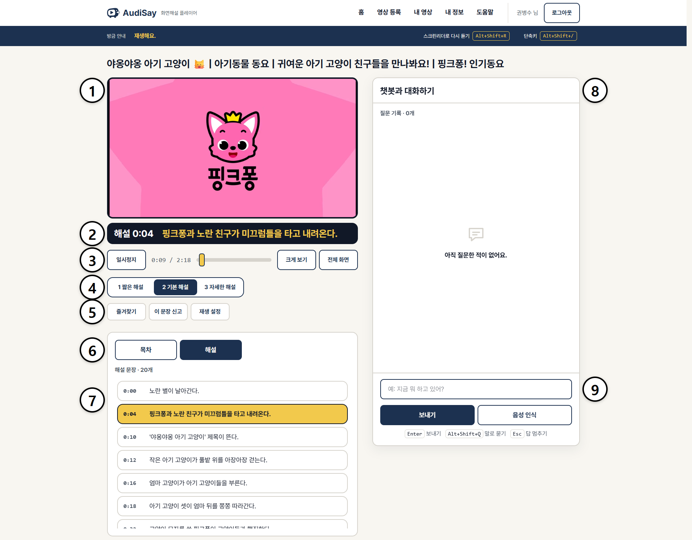</td>
  </tr>
  <tr>
    <td>보기 전에 AI가 만든 요약을 먼저 듣고 무슨 내용인지 미리 알 수 있습니다.</td>
    <td>해설 상세도를 짧은·기본·자세한 3단계로 고르고, 목차와 해설 문장으로 원하는 시각에 이동합니다.</td>
  </tr>
  <tr>
    <th>재생 설정</th>
    <th>크게 보기</th>
  </tr>
  <tr>
    <td>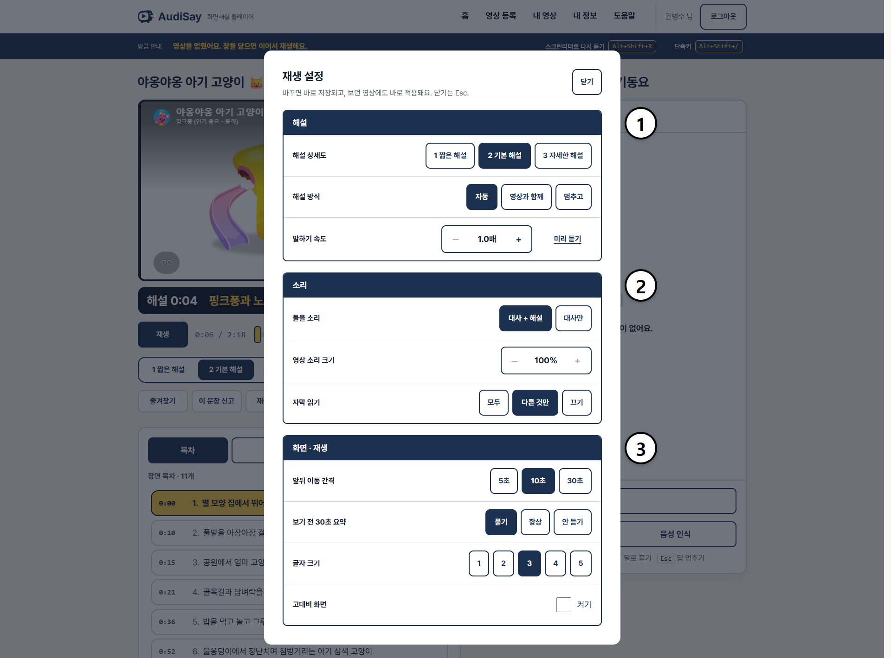</td>
    <td>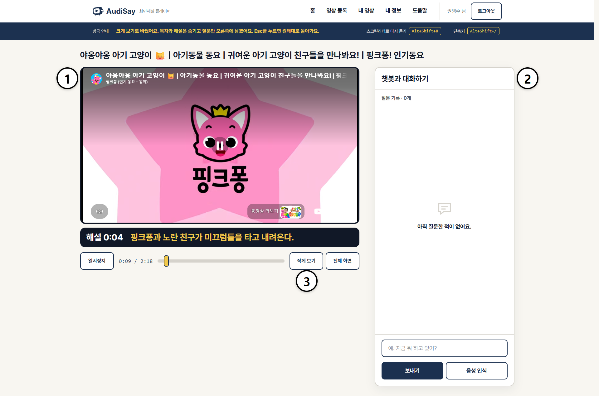</td>
  </tr>
  <tr>
    <td>해설 방식(자동·영상과 함께·멈추고), 말하기 속도, 자막 읽기, 글자 크기, 고대비를 바꿉니다.</td>
    <td>저시력 사용자를 위해 영상을 크게 보여 주고 챗봇만 옆에 남깁니다.</td>
  </tr>
</table>

### 3. 묻고, 장면으로 이동하기

<table>
  <tr>
    <th width="50%">질문하기 · 장면 이동</th>
    <th width="50%">문장 신고</th>
  </tr>
  <tr>
    <td>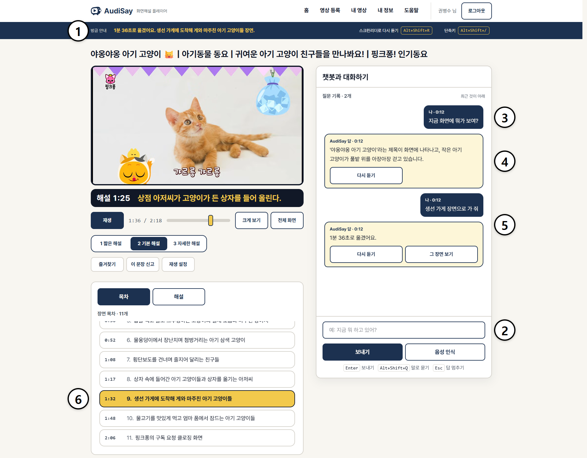</td>
    <td>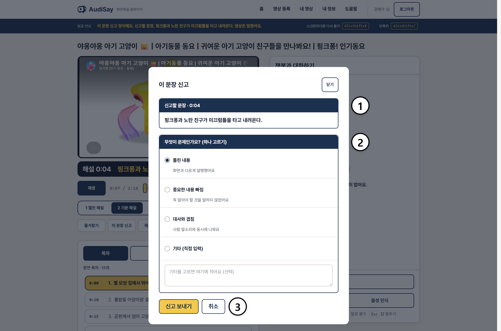</td>
  </tr>
  <tr>
    <td>질문한 시점의 장면을 바탕으로 답하고 음성으로 읽어 줍니다. 말로 설명한 장면을 찾아 그 시각으로 옮깁니다.</td>
    <td>해설이 틀렸거나 대사와 겹치면 방금 들은 문장을 바로 신고합니다.</td>
  </tr>
</table>

### 4. 관리자

<table>
  <tr>
    <th width="50%">신고 상세 · 해설 수정</th>
    <th width="50%">AI 사용량 통계</th>
  </tr>
  <tr>
    <td>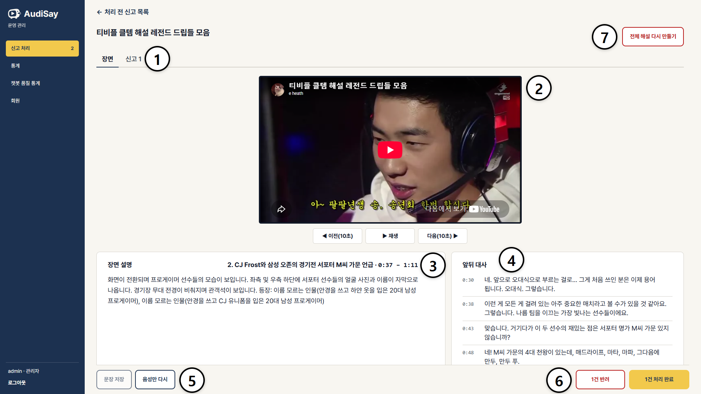</td>
    <td>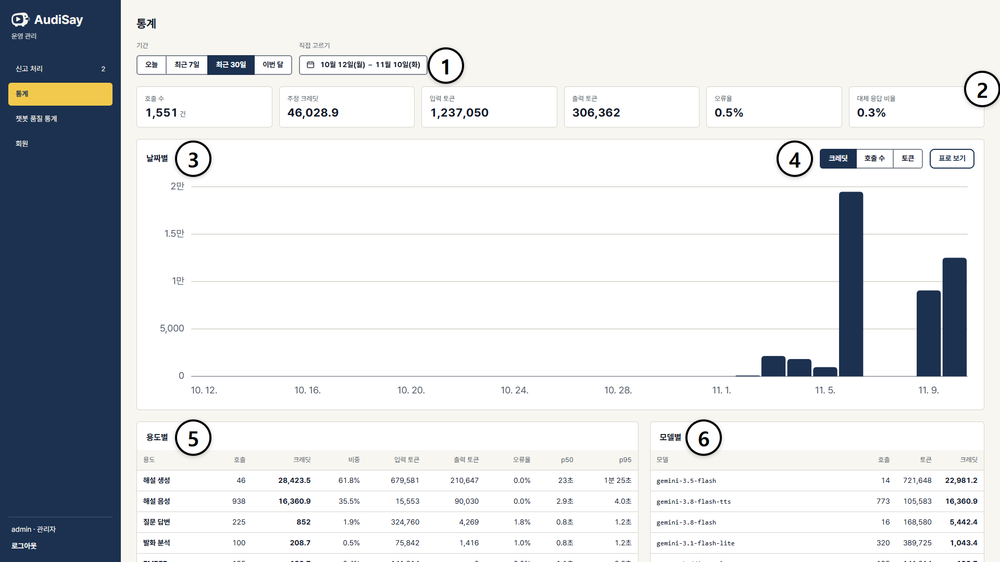</td>
  </tr>
  <tr>
    <td>신고된 장면을 확인하고 해설 문장을 고치거나 음성·해설 전체를 다시 만듭니다.</td>
    <td>AI 호출 수, 토큰, 추정 크레딧, 오류율을 용도·모델별로 봅니다.</td>
  </tr>
</table>

> 화면별 자세한 설명은 [시연 시나리오](exec/시연_시나리오.md)에 있습니다.

<br />

## ♿ 접근성 설계

**사용자는 화면을 보지 않고 듣고 조작합니다.** 모든 화면은 이 전제에서 만들었습니다.

| 원칙 | 구현 |
| --- | --- |
| ⌨️ 키보드로 모든 기능 조작 | 단축키는 모두 <kbd>Alt</kbd>+<kbd>Shift</kbd>+키. 화면낭독기의 한 글자 이동 키와 겹치지 않습니다. |
| 🔊 낭독기와 소리 겹침 방지 | 해설·안내 음성은 한 번에 하나만 내고, 화면낭독기가 읽는 동안에는 기다렸다가 시작합니다. |
| 📢 지금 위치 안내 | 화면에 들어오면 "홈이에요. 검색 칸에 있어요."처럼 위치를 읽어 주고, <kbd>Alt</kbd>+<kbd>Shift</kbd>+<kbd>R</kbd>로 다시 듣습니다. |
| 🌗 고대비 화면 | 색을 토큰으로만 써서 고대비 모드에서 전체가 함께 바뀝니다. |
| 🔠 글자 크기 5단계 | 크기를 rem 단위로만 써서 화면 전체가 함께 커집니다. |
| ✅ 자동 검사 | ESLint jsx-a11y(strict)와 axe 접근성 테스트를 빌드 때 함께 돌립니다. |

<br />

## 🛠 기술 스택

### Frontend


### Backend


### AI


-615CED?style=for-the-badge)


### Data · Messaging


### Infra


### 협업


<br />

## 🏗 시스템 구조

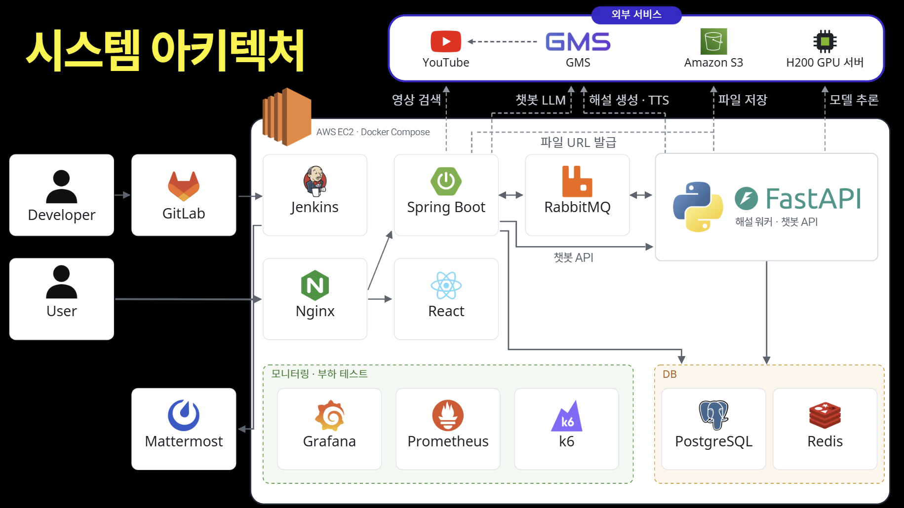

**해설이 만들어지는 순서**

| 단계 | 큐 | 하는 일 |
| --- | --- | --- |
| 1 | `job.prepare` | 영상을 분석해 전체 해설과 조각 구간을 만듭니다. |
| 2 | `job.describe` | 조각마다 해설 문장을 배치하고 검증합니다. |
| 3 | `job.merge` | 성공한 조각을 모아 해설·목차를 저장합니다. |
| 4 | `job.tts` | 해설 문장과 요약을 음성(mp3)으로 만들어 S3에 올립니다. |

- 진행 상황은 SSE로 브라우저에 바로 전달합니다.
- 실패한 메시지는 10초·30초 뒤 다시 시도하고, 3번째 실패는 DLQ로 보냅니다.
- `main`에 병합하면 Jenkins가 빌드·배포하고 헬스 체크 결과를 Mattermost로 알립니다.

<br />

## 📁 폴더 구조

```
S15P31D101/
├── frontend/     React 웹 (화면, 접근성 부품, 단축키, 해설 재생)
├── backend/      Spring Boot API 서버 (회원, 영상, 해설 작업, 챗봇, 신고, 관리자)
├── ai/           FastAPI AI 워커 (해설 생성 파이프라인, 챗봇 내부 API)
│   └── gpu_server/   GPU 오픈소스 추론 서버
├── infra/        docker-compose, Nginx, Jenkins, 모니터링 설정
├── exec/         포팅 매뉴얼, 외부 서비스 정리, DB 덤프, 시연 시나리오
├── Jenkinsfile   빌드·배포 파이프라인
└── convention.md Git 컨벤션
```

<br />

## 🚀 시작하기

```bash
git clone https://lab.ssafy.com/s15-final/S15P31D101.git
cd S15P31D101
cp .env.example .env      # 비밀 키 값은 팀 내부에서 따로 공유
docker compose -f infra/docker-compose.local.yml --env-file .env up -d   # 로컬 DB·Redis·RabbitMQ 실행
```

서비스별 실행 방법은 [frontend/README.md](frontend/README.md), [ai/README.md](ai/README.md)를, 서버 배포는 [포팅 매뉴얼](exec/01_포팅매뉴얼.pdf)을 참고하세요.

<br />

## 📚 문서

| 문서 | 내용 |
| --- | --- |
| [convention.md](convention.md) | 브랜치 전략, 커밋 메시지, MR 규칙 |
| [frontend/README.md](frontend/README.md) | 프론트엔드 실행 방법, 접근성 규칙, 새 화면 체크리스트 |
| [ai/README.md](ai/README.md) | AI 워커 큐 구성, 로컬 실행, 테스트 |
| [ai/gpu_server/README.md](ai/gpu_server/README.md) | GPU 추론 서버 설치·버전 기록 |
| [exec/01_포팅매뉴얼.pdf](exec/01_포팅매뉴얼.pdf) | 서버 빌드·배포 절차 |
| [exec/02_외부서비스.pdf](exec/02_외부서비스.pdf) | 외부 서비스 정보 |
| [exec/시연_시나리오.md](exec/시연_시나리오.md) | 화면별 시연 시나리오 |

<br />

## 개인 개발 기록 — 이윤우 (백엔드·AI)

위까지는 팀이 함께 쓴 서비스 소개이고, 여기부터는 제가 맡은 부분의 요약입니다. 구현 과정과 측정 조건 전체는 [PORTFOLIO.md](PORTFOLIO.md)에 있습니다.

### 1. Project Overview

- 프로젝트명: AudiSay — 시각장애인을 위한 AI 영상 화면해설 서비스
- 개발 기간: 2026.10.13 ~ 2026.11.18 (기획 포함, SSAFY 15기 2학기 자율 프로젝트)
- 팀 구성: 6명 (AI·백엔드 1(본인) · 백엔드 1 · AI 1 · 인프라·프론트 1 · 프론트 2)
- 담당 역할: 백엔드·AI 팀원. 팀장은 따로 있습니다
- GitHub: https://github.com/luster-woo/AudiSay
- 기술 스택 (제가 쓴 것): Java 21 · Spring Boot 4 · JPA · Flyway · PostgreSQL 16 + pgvector · Redis · RabbitMQ · Resilience4j · SSE · ONNX Runtime · JUnit · k6

### 2. My Contribution

- 해설 생성 작업 흐름 (Outbox, 이벤트 중복 처리, 진행률 SSE, 멈춘 작업 정리)
- 해설 조회 API 4개
- 음성 챗봇 전체 (의도 분류, 장면 찾기, 질문 답변, 화면 다시 보기)
- 인증 서류 OCR 판정, LLM 호출 공통부, 관리자 통계 API
- 장애 주입 측정 도구, 챗봇 평가 문항 192개, k6 부하 테스트

해설을 만드는 AI 워커와 GPU 서버, 회원 인증과 업로드, 인프라·CI/CD, 화면은 팀원의 작업입니다. 코드의 상당 부분은 Claude와 함께 썼고, 구조와 대안 선택, 평가 문항, 측정과 검증은 직접 했습니다.

### 3. Architecture

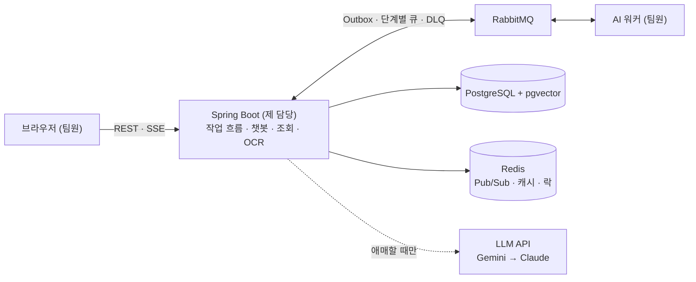

- 서버 간 통신: 브라우저와는 REST·SSE, AI 워커와는 RabbitMQ 메시지(단계별 큐, 재시도, DLQ), Spring 서버끼리는 Redis Pub/Sub
- 데이터 흐름: 작업과 메시지를 같은 트랜잭션에 저장 → 커밋 뒤 발행·확인 → 워커 이벤트마다 작업 행을 잠그고 상태 변경 → 해설 공개 뒤 장면 검색 색인
- 데이터베이스: PostgreSQL 16 + pgvector(Flyway). 제가 추가한 것은 Outbox 메시지 표, 챗봇 관련 칸, 장면 검색 색인입니다

### 4. Key Implementations

| 기능 | 구현 목적 | 적용 기술 | 기술적 고려사항 |
|---|---|---|---|
| 해설 생성 작업 흐름 | 메시지가 사라지거나 겹쳐도 작업이 멈추지 않게 | RabbitMQ · Outbox · 행 잠금 · Redis Pub/Sub | 최소 한 번 전달 + 멱등 처리. 옛 방식과 지금 방식을 스위치로 바꿔 비교 |
| 음성 챗봇 | 말 한 번마다 붙는 LLM 비용과 지연 줄이기 | 규칙 분류 · pgvector · RRF · SSE | 규칙이 먼저, 애매한 말만 LLM. 질문한 시각까지의 해설만 자료로 사용 |
| 해설 조회 | 동시 요청에서 느린 응답 | Redis 캐시 · gzip | 응답 전체가 아니라 음성 파일별 서명 주소만 캐시 |
| 인증 서류 OCR | 주민번호가 있는 서류를 밖으로 보내지 않기 | PaddleOCR ONNX | 트랜잭션 밖 실행, 동시 1건 제한 |

### 5. Technical Challenges

| Situation | Cause | Solution | Result |
|---|---|---|---|
| 마지막 조각 이벤트가 동시에 오면 작업이 멈춤 | 두 트랜잭션이 서로 커밋 전 상태를 읽음 | 이벤트마다 작업 행 잠금 | 합치기 누락 30/100 → 0 (로컬, 이벤트 1,000개 동시) |
| 브로커가 꺼져도 API는 202를 돌려줌 | 커밋 뒤 바로 발행해 실패하면 메시지가 사라짐 | Outbox, 발행 확인, 재발행 | 메시지 유실 50/50 → 0 (로컬, RabbitMQ 40초 중단) |
| 해설 조회가 느림 | N+1이 아니라 문장마다 하는 음성 주소 서명 | 서명 주소 캐시, gzip | p95 562ms → 61ms (로컬, 동시 30) |

### 6. Performance & Results

| 항목 | 조건 | 값 |
|---|---|---|
| 챗봇 의도 분류 | 직접 만든 112문항 | 95.5% → 99.1%, 분류 비용 −77% |
| 장면 찾기 | 98문항 | 정답 80% → 87%, LLM 비용 −58% |
| 부분 실패 처리 | 로컬, 조각 실패율 10% 주입 | 작업 실패 67% → 13% |
| 배포 서버 해설 조회 | EC2 4코어, 읽기 API만 | 초당 250건까지 여유, 300건이 한계 |
| 인증 서류 OCR | 견본 24장 | 판정 24/24, 한 장 0.96초 |

로컬 값은 PC 한 대에서 잰 것이고 실사용자 데이터는 없습니다.

### 7. Retrospective

- 배운 점: 정상처럼 보이는 실패는 일부러 만들어 봐야 보입니다. 장치를 넣을 때마다 끄고 켠 비교와 조건을 같이 남겼습니다
- 아쉬웠던 점: 측정이 로컬 PC와 제가 만든 문항 기준입니다. 부하 테스트에서 첫 숫자를 결론으로 말했다가 다시 재서 고친 일이 두 번 있었습니다
- 다시 한다면: 해설 조회 처리량이 더 필요해지면 커넥션 풀을 늘리기 전에 공개된 해설 응답을 캐시하겠습니다
