# 시연 시나리오

## 랜딩 페이지
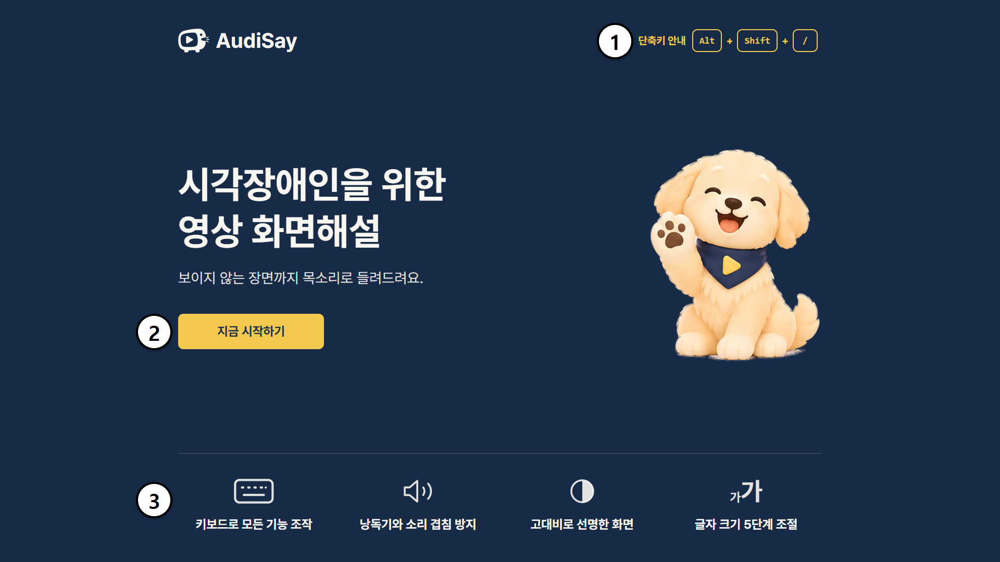
1. 단축키 안내
    - Alt + Shift + / 를 누르면 지금 화면에서 쓸 수 있는 단축키를 들을 수 있습니다.
2. 지금 시작하기
    - 지금 시작하기 버튼을 눌러 로그인 페이지로 이동할 수 있습니다.
3. 접근성 특징 소개
    - 키보드로 모든 기능 조작, 화면낭독기와 소리 겹침 방지, 고대비 화면, 글자 크기 5단계 조절 등 AudiSay의 접근성 특징을 확인할 수 있습니다.

## 로그인 페이지
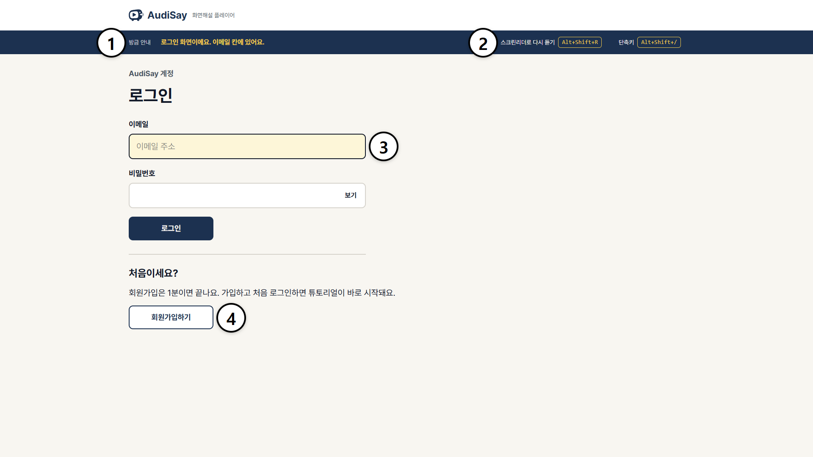
1. 방금 안내 띠
    - 화면에 들어오거나 무언가를 했을 때 그 결과를 글자로 보여 주고 화면낭독기로 읽어 줍니다.
    - 화면이 보이지 않아도 지금 어느 화면의 어느 칸에 있는지 알 수 있습니다.
2. 스크린리더로 다시 듣기 · 단축키
    - Alt + Shift + R 로 방금 들은 안내를 화면낭독기로 다시 들을 수 있고, Alt + Shift + / 로 지금 화면의 단축키를 들을 수 있습니다.
3. 이메일 로그인
    - 이메일과 비밀번호로 로그인할 수 있으며, '보기' 버튼으로 입력한 비밀번호를 확인할 수 있습니다.
4. 회원가입하기
    - 회원가입 페이지로 이동할 수 있습니다. 가입하고 처음 로그인하면 튜토리얼이 바로 시작됩니다.

## 회원가입
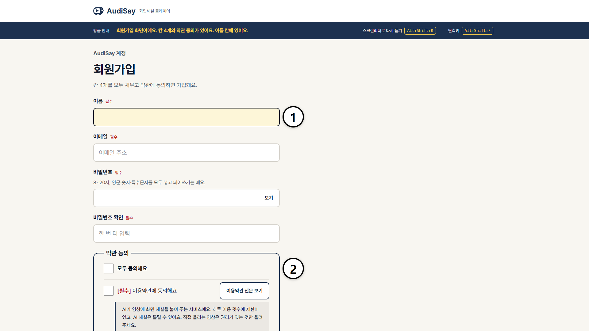
1. 회원 정보 입력
    - 이름, 이메일, 비밀번호, 비밀번호 확인 4칸을 입력합니다.
    - 비밀번호는 8~20자이며 영문·숫자·특수문자를 모두 넣고 띄어쓰기는 뺍니다.
2. 약관 동의
    - '모두 동의해요'로 한 번에 동의하거나 약관별로 동의할 수 있으며, '전문 보기' 버튼으로 약관 전체를 읽을 수 있습니다.

## 튜토리얼
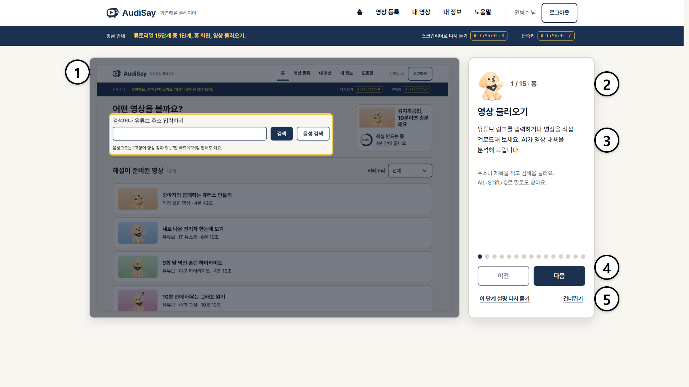
1. 예시 화면
    - 실제 화면을 보여 주고, 지금 설명하는 부분을 노란 테두리로 강조합니다.
    - 홈 → 영상 등록 → 유튜브 영상 확인 → 해설 만들기 → 영상 보기 → 내 영상 → 내 정보 순서로 15단계에 걸쳐 주요 기능을 안내합니다.
2. 단계 표시
    - "1 / 15 · 홈"처럼 지금 몇 번째 단계인지와 어느 화면인지 알려 줍니다.
3. 단계 설명
    - 기능 이름과 설명, 아래에 사용 방법(단축키)을 보여 주고 화면낭독기로 읽어 줍니다.
4. 진행 점 · 이전/다음
    - 진행 점으로 전체 중 어디까지 왔는지 확인하고, '이전'·'다음'으로 단계를 오갈 수 있습니다.
5. 다시 듣기 · 건너뛰기
    - '이 단계 설명 다시 듣기'로 설명을 다시 듣거나 '건너뛰기'로 튜토리얼을 마칠 수 있습니다.
    - 튜토리얼은 Alt + Shift + T 로 언제든 다시 볼 수 있습니다.

## 홈 화면
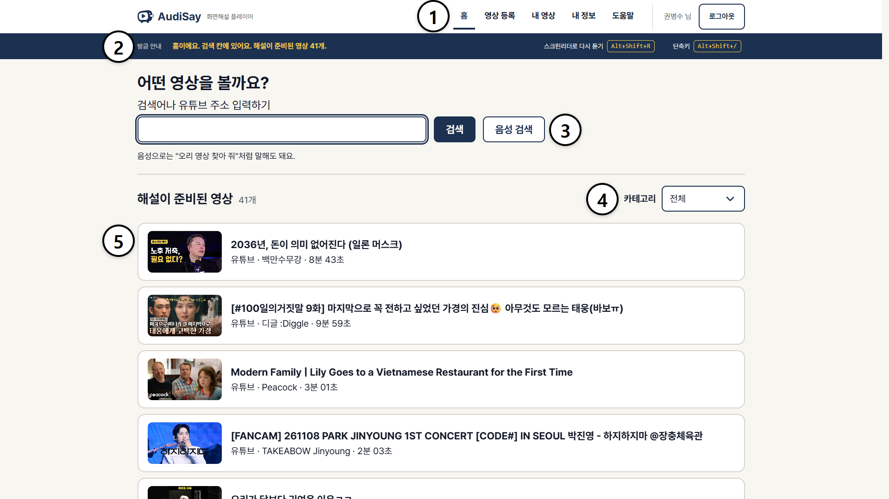
1. 주 메뉴
    - 홈, 영상 등록, 내 영상, 내 정보, 도움말로 이동하거나 로그아웃할 수 있습니다.
2. 방금 안내 띠
    - 홈에 들어오면 "홈이에요. 검색 칸에 있어요. 해설이 준비된 영상 41개."처럼 현재 위치와 화면 상태를 알려 줍니다.
3. 검색 및 음성 검색
    - 검색어나 유튜브 주소를 입력해 영상을 찾을 수 있습니다.
    - '음성 검색' 버튼(Alt + Shift + Q)으로 "오리 영상 찾아 줘"처럼 말로 영상을 찾을 수 있습니다.
4. 카테고리 필터
    - 카테고리를 골라 해설이 준비된 영상을 분류별로 볼 수 있습니다.
5. 해설이 준비된 영상 목록
    - 해설이 이미 만들어진 영상의 제목, 채널, 길이를 확인하고 바로 재생 화면으로 이동할 수 있습니다.

## 검색 결과
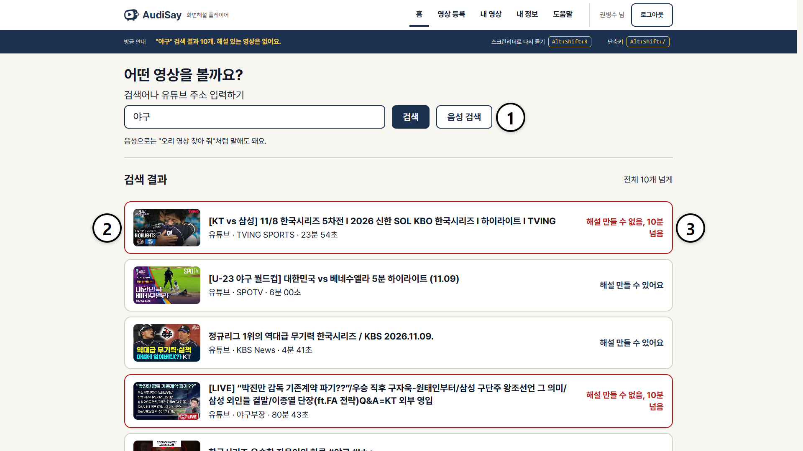
1. 검색창
    - 입력한 검색어로 유튜브 영상을 찾습니다. 방금 안내 띠가 결과 개수와 해설이 있는 영상 수를 알려 줍니다.
2. 검색 결과 목록
    - 검색된 영상의 썸네일, 제목, 채널, 길이를 확인하고 선택해 해설을 만들거나 볼 수 있습니다.
3. 해설 가능 여부
    - 영상마다 '해설 만들 수 있어요' 또는 '해설 만들 수 없음, 10분 넘음'처럼 해설을 만들 수 있는지와 그 이유를 바로 보여 줍니다.

## 유튜브 주소 확인
> 유튜브 주소 확인 · 해설 생성 진행 화면의 시연 영상: [산토끼](https://www.youtube.com/watch?v=rkg-P1lCW98) © 다나랜드(DANALAND), [CC BY 3.0](https://creativecommons.org/licenses/by/3.0/deed.ko)

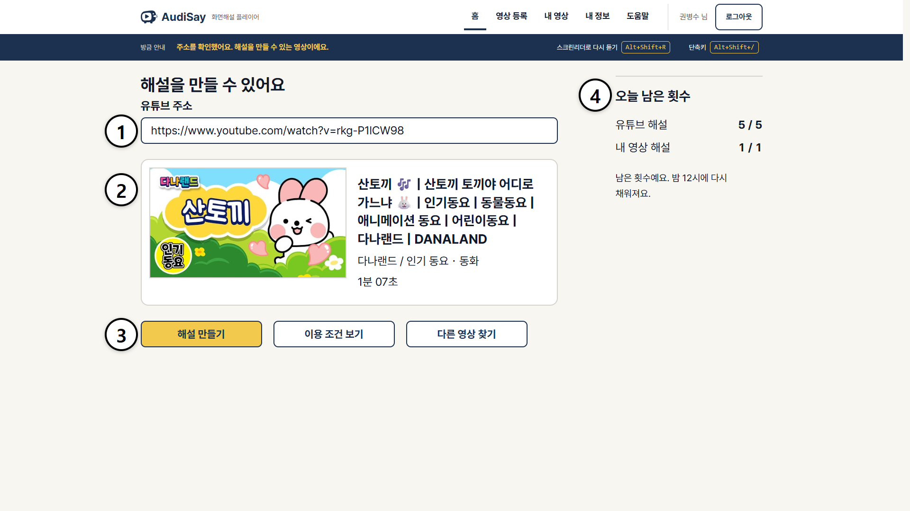
1. 유튜브 주소
    - 검색창에 붙여 넣은 유튜브 주소를 확인합니다. 확인만 하고 이용 횟수는 쓰지 않습니다.
2. 영상 정보
    - 영상의 썸네일, 제목, 채널, 길이를 확인할 수 있습니다.
3. 해설 만들기 버튼
    - '해설 만들기'로 해설 생성을 요청하고, '이용 조건 보기'로 길이·횟수 제한을 확인하거나, '다른 영상 찾기'로 돌아갈 수 있습니다.
    - 이미 해설이 있는 영상이면 '바로 보기' 버튼이 나오고 횟수를 쓰지 않고 바로 볼 수 있습니다.
4. 오늘 남은 횟수
    - 유튜브 해설과 내 영상 해설의 오늘 남은 횟수를 확인할 수 있으며, 매일 밤 12시에 다시 채워집니다.

## 해설 생성 진행
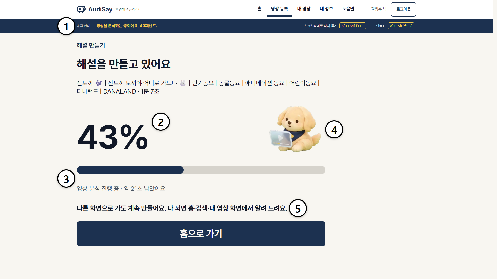
1. 방금 안내 띠
    - "영상을 분석하는 중이에요, 40퍼센트."처럼 진행 상황을 읽어 줍니다.
2. 진행률
    - 해설 생성 진행률(%)을 크게 보여 줍니다.
3. 진행 막대 · 남은 시간
    - 진행 막대와 함께 지금 하는 단계(영상 분석, 해설 음성 만들기 등)와 남은 예상 시간을 확인할 수 있습니다.
4. 오디 캐릭터
    - 해설을 만드는 동안 오디가 태블릿으로 영상을 보며 움직입니다. 그림을 누르면 움직임을 멈출 수 있습니다.
5. 백그라운드 생성 안내
    - 다른 화면으로 이동해도 해설은 계속 만들어지며, 다 되면 홈·검색·내 영상 화면에서 알려 줍니다.

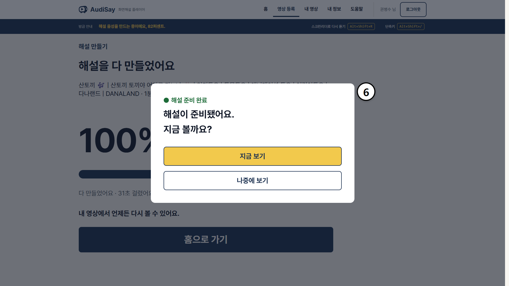

6. 해설 준비 완료 알림
    - 해설이 다 만들어지면 알림 창이 뜨고, '지금 보기'로 바로 재생하거나 '나중에 보기'로 닫을 수 있습니다.

## 30초 요약
> 30초 요약 ~ 문장 신고 화면의 시연 영상: [야옹야옹 아기 고양이](https://www.youtube.com/watch?v=1axayVZ-dZY) © 핑크퐁(Pinkfong), [CC BY 3.0](https://creativecommons.org/licenses/by/3.0/deed.ko)

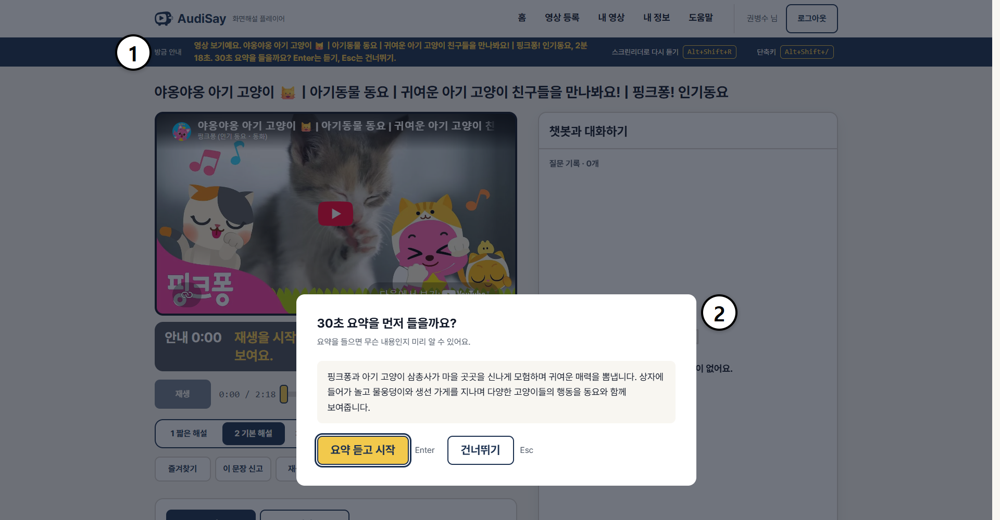
1. 방금 안내 띠
    - 영상 제목과 길이를 알려 주고, Enter는 요약 듣기 · Esc는 건너뛰기라고 안내합니다.
2. 30초 요약 창
    - 영상을 보기 전에 AI가 만든 30초 요약을 먼저 들으면 무슨 내용인지 미리 알 수 있습니다.
    - '요약 듣고 시작'(Enter) 또는 '건너뛰기'(Esc)를 고를 수 있으며, 요약을 다 들으면 창이 저절로 닫힙니다.

## 영상 보기
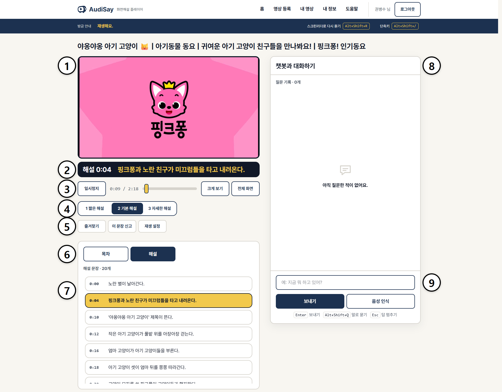
1. 영상 플레이어
    - 유튜브 영상을 재생합니다. 대사가 없는 사이에 화면해설 음성이 나옵니다.
2. 지금 읽는 해설
    - 지금 읽고 있는 해설 문장과 그 시각을 크게 보여 줍니다.
3. 재생 조작
    - 재생/일시정지, 현재 위치·전체 길이, 크게 보기, 전체 화면 버튼이 있습니다.
    - 키보드 단축키(Alt + Shift + K 재생·멈춤, J·L 뒤로·앞으로)로도 조작할 수 있습니다.
4. 해설 상세도
    - '1 짧은 해설', '2 기본 해설', '3 자세한 해설' 중 원하는 해설 길이를 고를 수 있습니다.
5. 기능 버튼
    - 즐겨찾기, 이 문장 신고, 재생 설정을 할 수 있습니다.
6. 목차 · 해설 탭
    - 영상 아래에서 '목차'와 '해설' 탭을 바꿔 가며 볼 수 있습니다.
7. 해설 문장 목록
    - 해설 탭에서는 전체 해설 문장을 시각과 함께 보여 주며, 지금 읽는 문장은 노란색으로 강조됩니다.
    - 목차 탭에서는 장면 목차를 보여 주며, 장면이나 문장을 고르면 그 시각으로 이동합니다.
8. 챗봇과 대화하기
    - 영상에 대해 질문하고 답을 받은 기록이 대화 형태로 쌓입니다.
9. 질문 입력
    - 궁금한 점을 글로 적어 '보내기'(Enter)를 누르거나 '음성 인식'(Alt + Shift + Q)으로 말로 물어볼 수 있습니다. 답을 듣다가 Esc를 누르면 멈춥니다.

## 질문하기 · 장면 이동
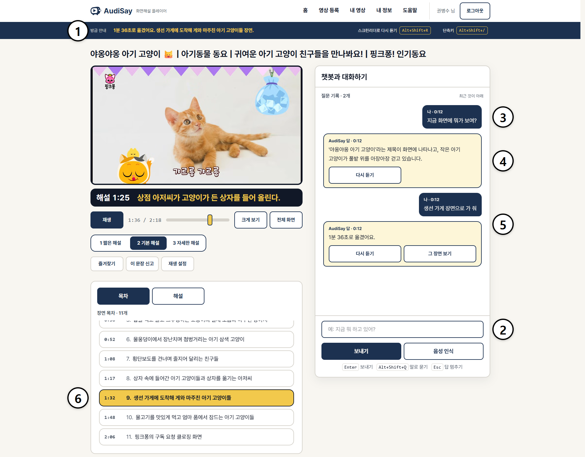
1. 방금 안내 띠
    - 명령을 처리한 결과를 알려 줍니다. (예: "1분 36초로 옮겼어요. 생선 가게에 도착해 게와 마주친 아기 고양이들 장면.")
2. 질문 입력
    - "지금 화면에 뭐가 보여?"처럼 질문하거나 "생선 가게 장면으로 가 줘"처럼 명령할 수 있습니다.
3. 내 질문
    - 질문한 내용과 질문한 영상 시각이 오른쪽 말풍선으로 기록됩니다.
4. AudiSay 답
    - 질문한 시점의 장면을 바탕으로 AI가 답하고, 답을 음성으로 읽어 줍니다. '다시 듣기'로 답을 다시 들을 수 있습니다.
5. 장면 이동 명령
    - 말로 원하는 장면을 설명하면 해당 장면을 찾아 그 시각으로 바로 이동합니다.
    - '그 장면 보기'로 옮긴 장면으로 다시 갈 수 있고, 비슷한 장면이 여러 곳이면 후보를 보여 주고 고르게 합니다.
6. 목차 강조
    - 장면을 옮기면 목차에서 지금 장면이 노란색으로 강조됩니다.

## 크게 보기
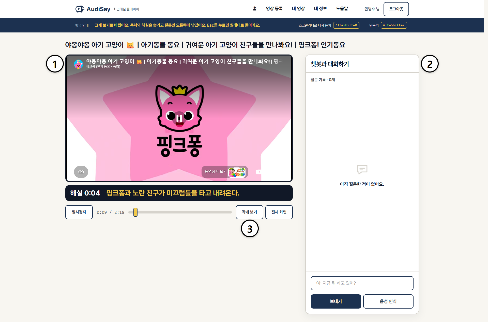
1. 크게 보기 화면
    - 저시력 사용자를 위해 영상을 크게 보여 줍니다.
2. 챗봇 패널
    - 목차와 해설은 숨기고 챗봇과 대화하기만 오른쪽에 남깁니다.
3. 작게 보기
    - '작게 보기' 버튼이나 Esc로 원래 화면으로 돌아갈 수 있습니다.

## 재생 설정
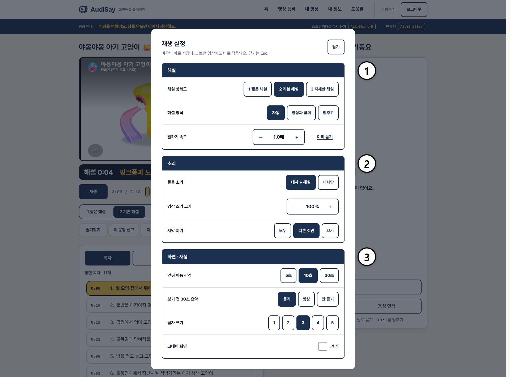
1. 해설 설정
    - 해설 상세도(짧은·기본·자세한), 해설 방식(자동·영상과 함께·멈추고), 말하기 속도를 바꾸고 '미리 듣기'로 확인할 수 있습니다.
2. 소리 설정
    - 들을 소리(대사 + 해설 / 대사만), 영상 소리 크기, 자막 읽기(모두·다른 것만·끄기)를 설정할 수 있습니다.
3. 화면 · 재생 설정
    - 앞뒤 이동 간격(5초·10초·30초), 보기 전 30초 요약(묻기·항상·안 듣기), 글자 크기(1~5단계), 고대비 화면을 설정할 수 있습니다.
    - 바꾼 설정은 바로 저장되고 보던 영상에도 바로 적용됩니다.

## 문장 신고
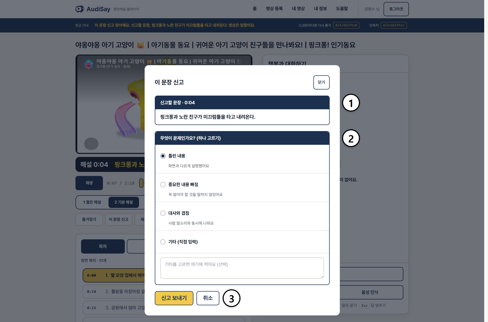
1. 신고할 문장
    - 방금 읽은 해설 문장과 그 시각이 자동으로 선택됩니다.
2. 신고 사유 선택
    - 틀린 내용, 중요한 내용 빠짐, 대사와 겹침, 기타(직접 입력) 중 하나를 고를 수 있습니다.
3. 신고 보내기
    - '신고 보내기'로 관리자에게 신고를 접수하거나 '취소'로 닫을 수 있습니다.

## 영상 등록
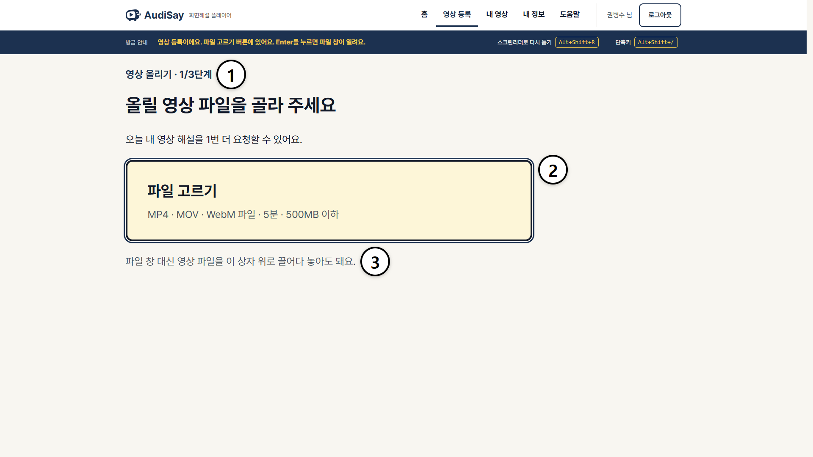
1. 업로드 단계
    - 영상 올리기는 파일 고르기 → 제목 → 공개 범위, 3단계로 진행되며 현재 단계를 보여 줍니다.
2. 파일 고르기
    - MP4·MOV·WebM 파일(5분·500MB 이하)을 골라 직접 올린 영상의 해설을 만들 수 있습니다.
    - 오늘 내 영상 해설을 몇 번 더 요청할 수 있는지도 알려 줍니다.
3. 끌어다 놓기
    - 파일 창 대신 영상 파일을 상자 위로 끌어다 놓아도 됩니다.

## 내 영상
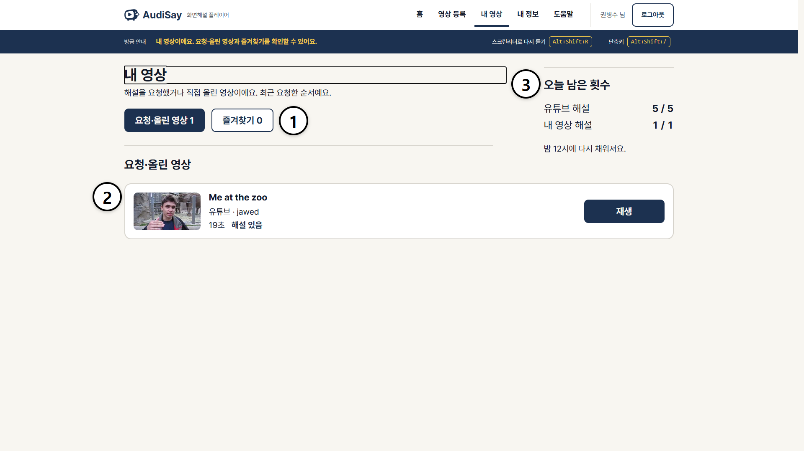
1. 영상 분류 탭
    - '요청·올린 영상'과 '즐겨찾기' 탭으로 내가 해설을 요청했거나 올린 영상, 즐겨찾기한 영상을 나눠 볼 수 있습니다.
2. 영상 목록
    - 영상의 제목, 채널, 길이, 해설 상태를 확인하고 '재생' 버튼으로 바로 볼 수 있습니다.
3. 오늘 남은 횟수
    - 유튜브 해설과 내 영상 해설의 오늘 남은 횟수를 확인할 수 있습니다.

## 내 정보
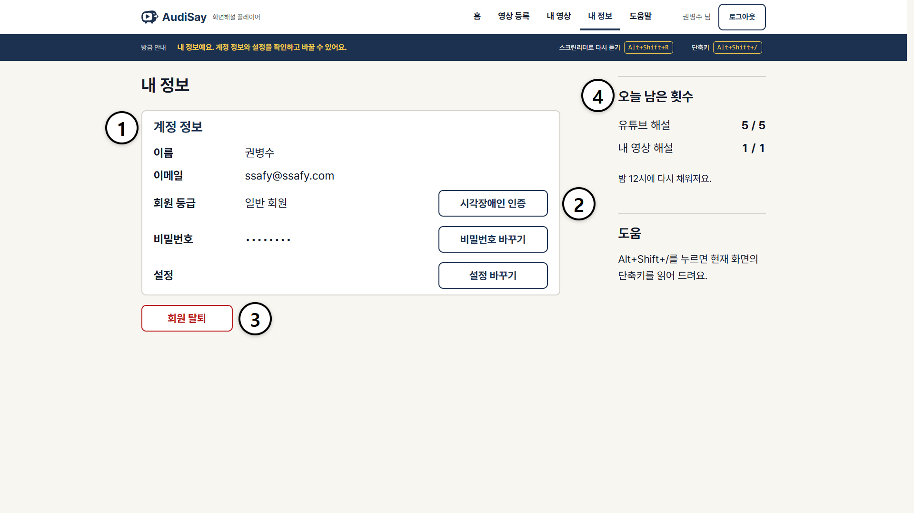
1. 계정 정보
    - 이름, 이메일, 회원 등급(일반 회원 / VIP)을 확인할 수 있습니다.
2. 계정 관리 버튼
    - '시각장애인 인증'으로 서류를 올려 인증하면 VIP가 되어 더 긴 영상의 해설을 만들고 하루에 더 많이 이용할 수 있습니다.
    - '비밀번호 바꾸기'로 비밀번호를, '설정 바꾸기'로 해설·소리·화면 설정을 바꿀 수 있습니다.
3. 회원 탈퇴
    - '회원 탈퇴' 버튼으로 탈퇴할 수 있습니다.
4. 오늘 남은 횟수 및 도움
    - 오늘 남은 이용 횟수와 단축키 도움말을 확인할 수 있습니다.

## 도움말
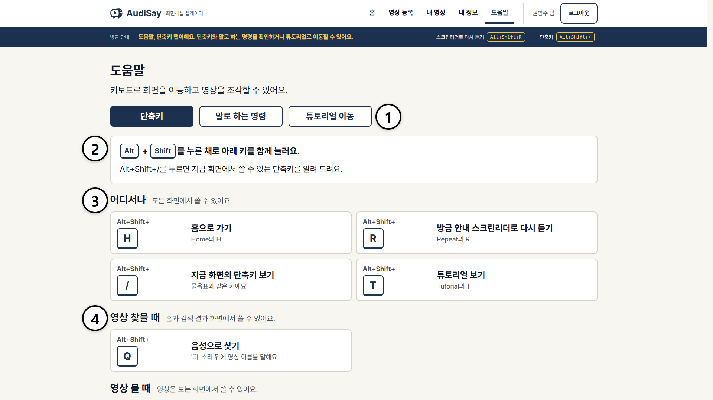
1. 도움말 탭
    - '단축키', '말로 하는 명령', '튜토리얼 이동' 탭으로 원하는 도움말을 볼 수 있습니다.
2. 단축키 기본 안내
    - Alt + Shift 를 누른 채 다른 키를 함께 누르는 단축키 사용법을 안내합니다.
3. 어디서나 쓰는 단축키
    - 홈으로 가기(H), 방금 안내 스크린리더로 다시 듣기(R), 지금 화면의 단축키 보기(/), 튜토리얼 보기(T)처럼 모든 화면에서 쓸 수 있는 단축키를 확인할 수 있습니다.
4. 상황별 단축키
    - 영상 찾을 때, 영상 볼 때 등 화면별로 쓸 수 있는 단축키를 확인할 수 있습니다.

## 관리자 - 신고 처리
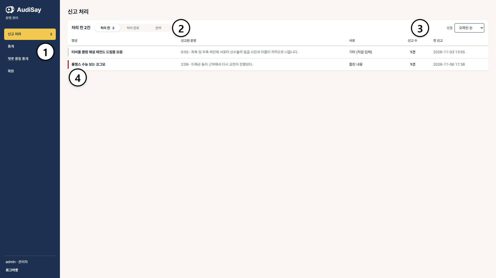
1. 관리자 메뉴
    - 신고 처리, 통계, 챗봇 품질 통계, 회원 관리 화면으로 이동할 수 있으며, 처리 전 신고 수가 표시됩니다.
2. 처리 상태 탭
    - 처리 전, 처리 완료, 반려 탭으로 신고를 상태별로 볼 수 있습니다.
3. 정렬
    - 오래된 순 또는 신고 많은 순으로 정렬할 수 있습니다.
4. 신고 목록
    - 신고된 영상, 해설 문장, 신고 사유, 신고 수, 첫 신고 일시를 확인하고 선택해 상세 화면으로 이동할 수 있습니다.

## 관리자 - 신고 상세
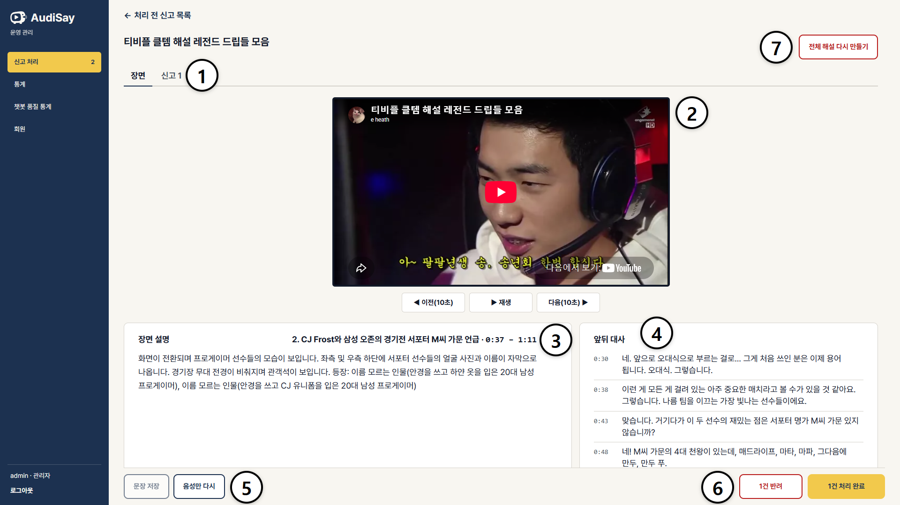
1. 장면 · 신고 탭
    - '장면' 탭에서 신고된 장면을 확인하고, '신고' 탭에서 이 문장에 들어온 신고 내용을 볼 수 있습니다.
2. 장면 영상
    - 신고된 장면의 영상을 재생하고 10초씩 앞뒤로 이동하며 확인할 수 있습니다.
3. 장면 설명
    - 해당 장면의 AI 장면 설명과 시간 구간을 확인하고 해설 문장을 직접 고칠 수 있습니다.
4. 앞뒤 대사
    - 장면 앞뒤의 대사를 시각과 함께 보여 줘 해설이 맞는지 판단할 수 있습니다.
5. 문장 수정 버튼
    - '문장 저장'으로 고친 해설 문장을 저장하고, '음성만 다시'로 해설 음성만 새로 만들 수 있습니다.
6. 신고 처리 버튼
    - 선택한 신고를 '반려'하거나 '처리 완료'할 수 있습니다.
7. 전체 해설 다시 만들기
    - 해설 전체에 문제가 있으면 영상의 해설을 처음부터 다시 만들 수 있습니다.

## 관리자 - 통계
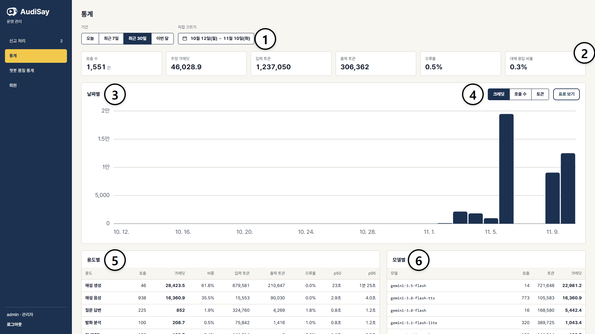
1. 기간 선택
    - 오늘, 최근 7일, 최근 30일, 이번 달 또는 직접 고른 기간의 통계를 볼 수 있습니다.
2. 요약 지표
    - AI 호출 수, 추정 크레딧, 입력·출력 토큰, 오류율, 대체 응답 비율을 한눈에 확인할 수 있습니다.
3. 날짜별 차트
    - 날짜별 사용량 추이를 막대 차트로 확인할 수 있습니다.
4. 차트 기준 · 표로 보기
    - 크레딧, 호출 수, 토큰 중 차트 기준을 바꿀 수 있으며, '표로 보기'로 같은 데이터를 표로 볼 수 있습니다.
5. 용도별 통계
    - 해설 생성, 해설 음성, 질문 답변, 발화 분석 등 용도별 호출 수, 크레딧, 비중, 토큰, 오류율, 응답 시간(p50·p95)을 확인할 수 있습니다.
6. 모델별 통계
    - AI 모델별 호출 수, 토큰, 크레딧을 확인할 수 있습니다.

## 관리자 - 챗봇 품질 통계
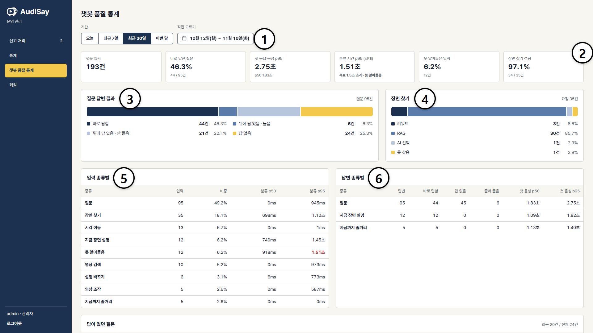
1. 기간 선택
    - 통계를 볼 기간을 고를 수 있습니다.
2. 품질 요약 지표
    - 챗봇 입력 수, 바로 답한 질문 비율, 첫 응답 음성 시간(p95), 분류 시간, 못 알아들은 입력 비율, 장면 찾기 성공률을 확인할 수 있습니다.
3. 질문 답변 결과
    - 바로 답함, 뒤에 답 있음(들음·안 들음), 답 없음 비율을 확인할 수 있습니다.
4. 장면 찾기
    - 장면 찾기 요청이 키워드, RAG, AI 선택 중 어떤 방식으로 찾았는지와 못 찾은 비율을 확인할 수 있습니다.
5. 입력 종류별 통계
    - 질문, 장면 찾기, 시각 이동, 지금 장면 설명, 영상 검색, 설정 바꾸기 등 입력 종류별 건수와 분류 시간을 확인할 수 있습니다.
6. 답변 종류별 통계
    - 답변 종류별 답변 수, 바로 답함·답 없음 건수, 첫 음성 응답 시간을 확인할 수 있습니다.

## 관리자 - 회원
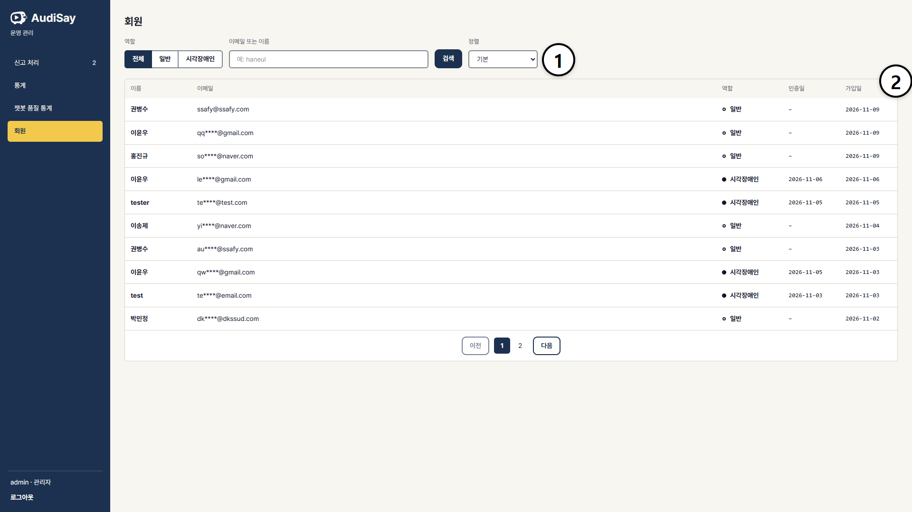
1. 회원 검색 · 필터
    - 역할(전체·일반·시각장애인)로 거르고, 이메일이나 이름으로 검색하고, 정렬 기준을 바꿀 수 있습니다.
2. 회원 목록
    - 회원의 이름, 이메일, 역할, 시각장애인 인증일, 가입일을 확인할 수 있습니다.
